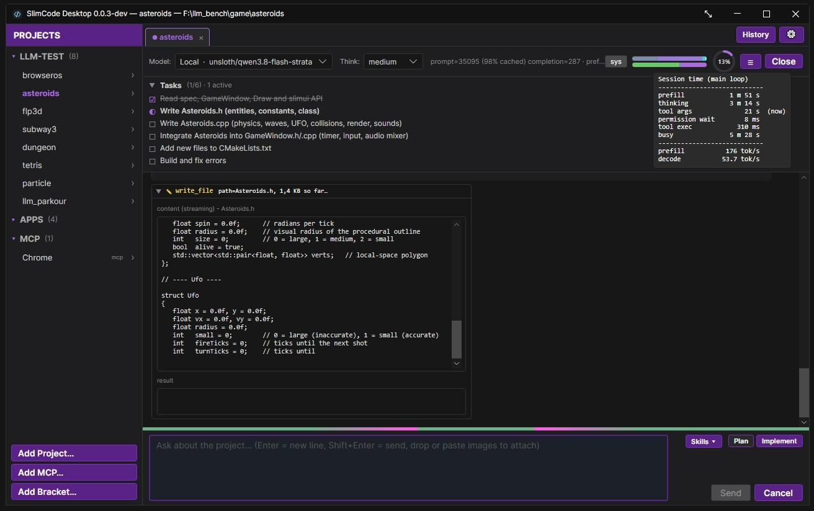

# SlimCode Desktop

A desktop coding agent harness built for **local LLMs**. It is deliberately smaller and
more restricted than the mainstream agent harnesses. The model works on the
files of one project folder, runs the build and test steps you defined, and
that's it. There is no shell, no web access, and nothing outside the project.

The main target is models served by **llama-swap** or **llama.cpp**
(`llama-server`) on your own hardware. Any OpenAI-compatible endpoint works
too, but that path is experimental and not tested well.

Runs on Windows. Linux support is experimental (see [Known limitations](#known-limitations)).



**AI Disclosure:** 
I defined the design, architecture and conventions and reviewed the changes.
Substantial parts of the source code have been and will be written by LLMs.

---

## Design principles

These choices define the project. Features that would weaken them are left out
on purpose.

> **Note:** these restrictions are design goals, **not a security guarantee**.
> Bugs or vulnerabilities in SlimCode, its dependencies or the platform may
> let a model get past them. Don't rely on them as your only protection for
> sensitive data or systems.

### Local LLMs first

SlimCode is tuned for a model on your own GPU, typically behind llama-swap:

- **The GPU belongs to the model.**
  The UI renders in software, with hardware acceleration off, so it takes no VRAM away from the model.
- **Model swaps are expensive.** 
  With llama-swap, asking for a different model evicts the loaded one. Background calls such as session titling therefore
  always reuse the model the session already runs, never a "cheaper" one.
- **Timing tracking.** 
  The timing (prefill, decode, thinking, tool calls etc.) are stored in the session history so you can see *where* the time went.
  Since especially local LLMs deployed models can be on the slower side, the actual model output is continuously streamed, so the progress can be observed.
  I.e. you can see the "write-tool call" streaming data live.

Other OpenAI-compatible (web-)providers (OpenAI, OpenRouter, vLLM, ...) can be added
in **Providers & models**. They work through the same client, but are not the
focus.

> **⚠ Warning: Web based OpenAI-compatible inference provider endpoints**  
> - API-keys you enter are stored **unencrypted**
> - have been tested sparsely only
> - If something goes wrong with "cache reads", which I have observed already, costs will explode
>
> Do not blame me, you have been warned!

### No arbitrary shell execution

The model **cannot run arbitrary commands**. 
There is no general `bash` tool accessible by the model.

Instead, you define the project's build and test steps yourself in
**Project setup**. The model gets two tools, `build` and `test`, which run
exactly those steps and take no arguments. Steps run in order and stop at the
first failure. Only failing steps (or steps you opt in) send their log back to
the model, trimmed to fit the context.

This keeps the model useful (it can edit, compile and test its own changes) without
handing it general shell access. If no steps are configured by you, the tools aren't offered at
all.

Technical note / Clarification: 
A "bash tool" is implemented in source to drive the build and test steps. 
But the "bash tool" itself cannot be accessed by the model via a general "bash" tool call.

### Sandbox-lite: the project folder

Every file tool (`read_file`, `list_dir`, `glob`, `grep`, `write_file`,
`edit_file`, `move_file`, `copy_file`, `delete_file`) is limited to the project root and
its subfolders. Paths that point outside it, whether absolute or via `..`, are
rejected.

It's *lite* because it's a path check, not an OS sandbox:

- Your defined build/test steps run in a normal shell with your user rights. 
  They're **trusted and unchecked** - you defined them.
- Symlinks and junctions are resolved to their real location before the check,
  so a link *inside* the project that points outside it is rejected, as is a
  dangling link. Linked folders are never entered when listing or searching.
  It is still a check done by SlimCode, not by the OS.
- Skills (see below) are read from their own folders, which can lie outside the
  project. That access is read-only.

> **⚠ Warning: build and test steps:**
> The build system such as CMake (CMakeLists.txt) is typically saved inside the project folder.
> The Agent can modify it within the regular rights permission gate. 
> The Agent could use this to exploit shell execution by build system proxy (build system modification + build tool call).
> The same obviously applies to the software you generated with the help of an agent, once you execute it.

### Offline by design

A coding project has **no network tools**: no web fetch, no web search, no
package lookups. The only network traffic is the connection to your LLM
endpoint. Anything the model should know about has to be in the project, in the
prompt, or in a skill.

(MCP projects are the exception, see [MCP projects](#mcp-projects-experimental).)

The online application update check in the about page happens only on the user's request.

### Human in the loop

- This software is most efficient with a developer prompting for targeted code changes / features
- A **permission gate** asks before write/execute tools run. Your answer can
  apply once, for the session, for the project, or globally (allow or deny).
  Deny always wins.
- **Plan mode**: 
  In Plan mode every write or execute call asks you, even if you allowed it before. 
- **Implement mode**: 
  Switch to **Implement** to enable the regular permission gate.
- Every decision goes into a per-project **audit log**, which you can view in
  the app.

---

## Features

- **One tab per project session**, with a sidebar of pinned projects. Projects
  can be grouped into *brackets*. Sessions are saved as they happen and can be
  resumed later.
- **"Project" is an actual concept in this harness** Once you add a folder/project
  you can setup build/test steps, default loaded skills etc.
- **Revert / fork** at any user turn: go back to an earlier point and try again.
- **Switch models mid-session** without starting over.
- **Task list**: the model keeps a visible to-do list (`set_tasks`) while it
  works.
- **Subagents**: the model can hand a self-contained job to a nested agent,
  either read-only (inspection tools only) or write-capable (file tools plus
  build/test). Each subagent gets its own child tab and goes through the same
  permission gate.
- **Skills**: reusable instruction modules (`<name>/SKILL.md`) that the model
  loads on demand with `use_skill`. They are picked up from a global folder,
  from Claude Code / Qwen skill folders in your user profile, and from the
  project (`<project>\.ai\skills` by default, so they can be shared via git).
- **Images**: Use the convenient **Clipboard wizard** feature (scissors symbol on clipboard update) to add an image. 
  Click it to preview and crop the image before attaching it to the message.  
  This needs a vision-capable model, e.g. `llama-server` with `--mmproj`.
  Enable/Disable via **Configuration → Application → Clipboard wizard**.
  Drop or paste images into the prompt works as well.
- **Markdown rendering** with GFM task lists, tables and LaTeX math.
- **F11** toggles full screen.

---

## Getting started

1. **Start your model server**, e.g. llama-swap or `llama-server`.
2. **Add it as a provider** in **Providers & models**: a name, the endpoint URL,
   and an API key if needed. Models can be discovered from the endpoint.
3. **Setup Model Parameters**, i.e. supported context length and reasoning modes.
4. **Add a project** (**Add Project…** in the sidebar) and pick its folder.
5. **Open Project setup** and add your **build** and **test** steps. Use
   *Test in terminal* to check them before the model does.
6. Start a **new session**. It opens in Plan mode.

---

## MCP projects (experimental)

Besides coding projects, you can add an **MCP project** (**Add MCP…**).
Its sessions get their tools from the Model Context Protocol servers you
configure (stdio or HTTP), and **only** from them. The built-in file tools,
build/test and subagents are not available.

> **⚠ Warning: the guard rails above do not apply to MCP projects.**
> SlimCode cannot see what an MCP tool does. It forwards the call and returns
> the result. An MCP server can reach the network, the whole file system, or
> anything else its implementation allows. A connection to an MCP server is
> exactly as safe or unsafe as that server. The sandbox, the no-shell rule
> and the offline rule are **not** enforced here.
>
> The permission gate still applies, but on the server's word: a tool the
> server marks as read-only is treated like a read tool and runs without
> asking. Every other tool asks first.
>
> HTTP headers, including bearer tokens, are stored in plaintext in the
> project's config file.

An MCP project still has to be pointed at a folder. That's a leftover of the
project model, not a feature: the folder only serves as the default working
directory for stdio servers. **Point it at an empty folder with no subfolders.**

---

## Profiles

All app-owned state (settings, sessions, permission policies, global skills,
crash log) lives in one folder per profile:

```
%APPDATA%\SlimCode\Default            # Windows, no argument
%APPDATA%\SlimCode\<name>             # --profile <name>
~/.config/SlimCode/<name>             # Linux
```

```pwsh
SlimCodeDesktop.exe --profile scratch     # or: dotnet run -- --profile scratch
```

Profiles are fully independent and share nothing. A non-default profile is
named in the window title and gets its own accent color by default
(**Settings → Application → Accent color**, `Auto` picks one from the profile
name). That makes it easy to tell two instances apart.

---

## Known limitations

- **Linux is experimental.** It was only briefly tested on a WSL Ubuntu
  distro.
- **Build/test steps are stored verbatim** in the shell syntax you wrote them
  in. A project set up on Windows won't run its steps on Linux, and vice versa.
- **Only the `reasoning_content` channel is captured as thinking.** Models that
  write `<think>` tags into the normal output show them inline.
- **No multimodal capability detection for llms.** 
  A text-only model fails the request with a server error.
- **No session compaction implemented yet.**
  Direct the main agent to use subagents to split work and use multiple sessions for large tasks. 
- The session list for a project is cached. A session written by another
  running instance shows up after switching projects or pressing refresh.

---

## Build & run

Prebuilt packages for Windows and Linux are on the [Releases](https://github.com/andj1210/SlimCodeDesktop/releases) page. 
To build from source, package or cut a release, see [doc/building.md](doc/building.md).

---

## Under the hood

- **.NET 10**, **Avalonia 12** (Fluent theme), software-rendered Skia.
- Custom Markdown renderer: **Markdig** → Avalonia controls.
- A single OpenAI-compatible streaming client (chat completions + SSE).
- Sessions are stored as append-only JSONL transcripts in the profile folder.
- Per-OS code is chosen at compile time (`Platform/Platform.{Windows,Linux}.cs`).

Architecture, conventions and design notes for contributors are in
[doc/DEVELOPER.md](doc/DEVELOPER.md).

---

## License

SlimCode Desktop is licensed under GPL-3.0-only. See [LICENSE.md](LICENSE.md) for
the license index and third-party components.
